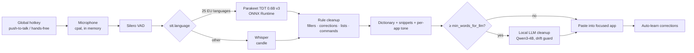

<div align="center">


### Free, open-source, 100% local AI voice dictation.

**Hold a hotkey, speak, release — clean text lands in whatever app has focus. No cloud, no account, no subscription.**

[](https://github.com/vraj-ai/openflow/actions/workflows/ci.yml)
[](LICENSE)
[](https://github.com/vraj-ai/openflow/stargazers)


[Demo](#demo) · [Features](#features) · [Install](#install) · [Usage](#usage) · [How it works](#how-it-works) · [Models](#models) · [Status](#status) · [Roadmap](#roadmap) · [Contributing](#contributing)

</div>

> [!NOTE]
> OpenFlow is early software: CLI + daemon only, no signed installer, and live hotkey/paste/microphone
> have not yet been verified on real desktop hardware. See [Status](#status) for exactly what is and isn't verified.

## Demo

<p align="center"></p>

[Watch the full demo (MP4)](assets/demo.mp4)

## Why OpenFlow?

<table>
<tr>
<td width="33%" valign="top"><b>🔒 Truly local</b><br/>Speech recognition, voice-activity detection and the cleanup LLM all run on your machine. The only network call is to <code>huggingface.co</code> when you download a model.</td>
<td width="33%" valign="top"><b>💸 Free forever</b><br/>MIT licensed. No account, no API key, no telemetry, no subscription.</td>
<td width="33%" valign="top"><b>🧩 Your models</b><br/>Pick the speech and cleanup models yourself from a pinned, SHA-checked catalog.</td>
</tr>
<tr>
<td valign="top"><b>✍️ Real cleanup</b><br/>Fillers, self-corrections, lists, spoken commands, punctuation — then an optional local LLM pass with a drift guard.</td>
<td valign="top"><b>🖥️ Cross-platform</b><br/>One Rust codebase for macOS, Windows and Linux (X11).</td>
<td valign="top"><b>🩺 Self-diagnosing</b><br/><code>openflow doctor</code> reports models, accelerator backend, native library and permissions.</td>
</tr>
</table>

## Features

- **Push-to-talk** — hold the dictate key, release to paste. A tap under `min_hold_ms` is ignored, Esc cancels.
- **Hands-free** — double-tap the dictate key, or press the hands-free chord (default `Fn+Space`); the next press stops.
- **Cleanup** — filler removal, self-corrections ("no wait, Tuesday"), list formatting, spoken commands ("new line", "press enter"), sentence case and punctuation, then an optional local LLM pass with a drift guard. Utterances under `min_words_for_llm` (default 6) skip the LLM.
- **Command Mode** — a second hotkey edits the selection ("make this more concise") through the cleanup model; if no text field is focused, the answer goes to a notification.
- **Personalisation** — dictionary (speech-model hotwords + LLM glossary + post-replace), snippets, and per-app tones matched by bundle id, app name or URL host.
- **Learns from you** — after a paste, it watches the field briefly and adds the words you corrected to the dictionary (`learning.auto_learn`).
- **Multilingual fallback** — Parakeet TDT 0.6B v3 covers 25 European languages; setting `stt.language` to anything else routes to Whisper.
- **Private history** — a local JSONL file you can clear or disable.

## OpenFlow vs Wispr Flow

Facts only. The Wispr Flow price comes from [wisprflow.ai/pricing](https://wisprflow.ai/pricing). The other Wispr Flow claims link to its help center pages. All checked 2026-10-21.

| | OpenFlow | Wispr Flow |
|---|---|---|
| Price | Free (MIT) | Free tier; Pro listed at $12/user/mo billed annually ($15 monthly) |
| Source code | Open source (MIT) | Proprietary |
| Where speech is processed | On your device | Cloud service (["Dictation is transcribed in the cloud"](https://docs.wisprflow.ai/articles/4048537120-what-to-expect-from-flow-accuracy-and-known-limitations)) |
| Works offline | Yes, after models are downloaded | No ([internet connection required for transcription](https://docs.wisprflow.ai/articles/2772472373-what-is-flow); on Android, [offline transcription is unavailable](https://docs.wisprflow.ai/articles/6344532666-android-system-requirements)) |
| Choose your own models | Yes (speech + cleanup) | No |
| Platforms | macOS, Windows, Linux (X11) — from source | Vendor-supported apps |
| Polished GUI / signed installer | Not yet (CLI + daemon) | Yes |

## Install

There is no signed installer yet; build from source (Rust 2024 edition, Rust 1.85+).

<details open>
<summary><b>macOS (Apple Silicon)</b></summary>

```bash
xcode-select --install
curl --proto '=https' --tlsv1.2 -sSf https://sh.rustup.rs | sh && source "$HOME/.cargo/env"
git clone https://github.com/vraj-ai/openflow && cd openflow
cargo build --release -p openflow-cli          # add --features metal for GPU Whisper/LLM
export ORT_DYLIB_PATH=/path/to/onnxruntime-osx-arm64-<ver>/lib/libonnxruntime.dylib
```

Grant your terminal **Microphone**, **Accessibility** and (if asked) **Input Monitoring** in System Settings › Privacy & Security, then restart it. Full guide: [docs/INSTALL-MAC.md](docs/INSTALL-MAC.md).
</details>

<details>
<summary><b>Linux</b></summary>

```bash
sudo apt-get install -y libasound2-dev         # cpal links ALSA
git clone https://github.com/vraj-ai/openflow && cd openflow
cargo build --release -p openflow-cli          # add --features cuda on an NVIDIA box
export ORT_DYLIB_PATH=/path/to/onnxruntime-linux-x64-<ver>/lib/libonnxruntime.so
```
Hotkeys and paste use X11.
</details>

<details>
<summary><b>Windows</b></summary>

```powershell
git clone https://github.com/vraj-ai/openflow; cd openflow
cargo build --release -p openflow-cli          # add --features cuda on an NVIDIA box
$env:ORT_DYLIB_PATH = "C:\path\to\onnxruntime-win-x64-<ver>\lib\onnxruntime.dll"
```
</details>

ONNX Runtime (for Parakeet + Silero VAD) is loaded at runtime from `ORT_DYLIB_PATH` — get the CPU build for your platform from the [ONNX Runtime releases](https://github.com/microsoft/onnxruntime/releases).

**Download models** (from huggingface.co, SHA-checked):

```bash
export OPENFLOW_MODELS=$PWD/models   # optional; defaults to the app data dir
./target/release/openflow models download parakeet-tdt-0.6b-v3
./target/release/openflow models download silero-vad
./target/release/openflow models download qwen3-4b-instruct-2507
./target/release/openflow doctor
```

## Usage

```bash
openflow daemon                # hold the hotkey and dictate — the real thing
openflow doctor                # environment, models, permissions
openflow models list           # catalog: speech, VAD, multilingual, cleanup models
openflow history --limit 20    # what was dictated
openflow settings              # the settings file path and contents
```

Headless surfaces (also how this repo is verified without a microphone):

```bash
openflow transcribe clip.wav                                # speech-to-text only
openflow clean "so um we should uh ship it friday"          # cleanup rules only
openflow dictate clip.wav --app com.tinyspeck.slackmacgap   # full pipeline, simulated desktop
openflow eval --asr eval/librispeech.jsonl                  # ASR WER and latency
openflow eval --cleanup eval/cleanup.jsonl --no-llm         # cleanup quality, rules only
```

<details>
<summary><code>openflow --help</code></summary>

```text
Local voice dictation with LLM cleanup

Usage: openflow [OPTIONS] <COMMAND>

Commands:
  models      List or download models
  transcribe  Speech-to-text only
  clean       Run the cleanup pipeline on text
  dictate     Run the full pipeline on a WAV against a simulated desktop and print what would be pasted
  dict        List, add or remove personal dictionary terms
  snippet     List, add or remove snippets
  set         Read or write one setting with a dotted key (see `openflow settings`)
  eval        Measure ASR WER and cleanup quality on the eval sets
  daemon      Listen for the global hotkey, record the microphone, paste into the focused app
  settings    Print the settings file path and contents
  doctor      Check this machine: models, accelerator backends, native library, permissions
  history     Show, clear or export the dictation history
  help        Print this message or the help of the given subcommand(s)

Options:
      --settings <SETTINGS>  Settings file (default: the app's settings.json)
  -h, --help                 Print help
  -V, --version              Print version
```
</details>

**Configuration.** Settings, dictionary and snippets are plain JSON under the app data dir. `openflow set <key> <value>` writes one field: `stt.model`, `stt.multilingual_model`, `stt.language`, `stt.vad`, `cleanup.llm_enabled`, `cleanup.llm_model`, `cleanup.min_words_for_llm`, `cleanup.rules.*`, `insertion.*`, `history.*`, `learning.*`, `styles.default_tone`. Hotkeys live in the same file (`hotkeys.dictate`, `hotkeys.command`, `hotkeys.hands_free`).

## How it works



| Crate | Owns |
|---|---|
| `crates/core` | Pure logic: hotkey state machine, text rules, dictionary, snippets, styles, guardrail, prompts, settings, history, dictation controller. Traits for STT, VAD, text generation and the desktop. |
| `crates/engines` | ONNX Runtime (Silero VAD, Parakeet) and candle (Whisper, GGUF LLMs), WAV decode/resample, Hugging Face downloader with SHA-256 verification. |
| `crates/platform` | Hotkey listeners and `Desktop` per OS: macOS CGEventTap + Accessibility API, Windows low-level hook + SendInput, Linux X11; microphone capture with cpal. |
| `crates/cli` | The `openflow` binary. |

Design reasoning: [`AGENTS.md`](AGENTS.md). Build history and verification log: [`PROGRESS.md`](PROGRESS.md).

## Models

All entries are pinned to a Hugging Face commit in [`crates/core/src/catalog.json`](crates/core/src/catalog.json). `openflow models list` shows the full catalog.

| Role | Default | Alternatives in catalog | Runtime |
|---|---|---|---|
| Speech-to-text | `parakeet-tdt-0.6b-v3` | `parakeet-tdt-0.6b-v2` | ONNX Runtime |
| Multilingual fallback | Whisper (`whisper-large-v3-turbo`) | `whisper-tiny` | candle |
| Voice activity | `silero-vad` | — | ONNX Runtime |
| Cleanup LLM | `qwen3-4b-instruct-2507` | `qwen3-1.7b`, `qwen3-8b`, `gemma-3-1b-it`, `llama-3.2-3b-instruct` | candle (GGUF) |

## Privacy

- No analytics, crash reporting, update check or accounts. The only HTTP client talks to `huggingface.co` for model downloads ([`crates/engines/src/download.rs`](crates/engines/src/download.rs)).
- Audio is held in memory for one utterance and never written to disk.
- History is local JSONL: `openflow history --clear`, or `openflow set history.enabled off`.

## Status

| Area | Status |
|---|---|
| Linux build + `cargo test --workspace` | ✅ Verified (154 passed, 0 failed, 10 model-backed tests ignored by default) |
| Pipeline end-to-end via CLI with real models (Parakeet, Whisper, Qwen cleanup) | ✅ Verified on a headless Linux CPU box |
| Speed, same clip on box CPU | Parakeet 274 ms vs Whisper-tiny 1394 ms |
| macOS arm64 / Windows | 🟡 Compile-gated only (CI); not run on real hardware |
| Live hotkey capture, paste into apps, microphone | ⚪ Not verified (no desktop/mic on build box) |
| CUDA / Metal backends | ⚪ Not verified |
| GUI (Tauri) | ⚪ Not built; CLI + daemon only |
| Code signing / notarisation | ⚪ Not done |

Details, numbers and open issues: [`PROGRESS.md`](PROGRESS.md). Release packaging: [`docs/RELEASING.md`](docs/RELEASING.md).

## Roadmap

- [x] **M1** — Core dictation loop
- [x] **M2** — Cleanup pipeline
- [x] **M3** — Personalisation (dictionary, snippets, styles, history)
- [x] **M4** — Command Mode, hands-free, Esc cancel
- [x] **M5** — Windows, Linux, CUDA (+ `doctor`)
- [x] **M6** — Polish and release (auto-learn, Whisper fallback, CI, docs)
- [ ] Verify live hotkey / paste / mic on real macOS, Windows and Linux desktops
- [ ] Verify CUDA and Metal backends
- [ ] Desktop GUI (Tauri)
- [ ] Signed, notarised installers

## Contributing

Issues and PRs are welcome — especially **real-hardware reports** from macOS, Windows and Linux desktops (`openflow doctor` output helps). Before a PR:

```bash
cargo fmt --all && cargo clippy --workspace && cargo test --workspace
```

Dependencies must be MIT, Apache-2.0, BSD, ISC, Zlib or MPL-2.0 — no GPL/LGPL/AGPL.

## Built by AI agents

OpenFlow was written by AI coding agents: [pi](https://github.com/badlogic/pi-mono) running DeepSeek V4.1 Flash, and Claude Code running Claude Opus 5.5, directed and reviewed by [@vraj-ai](https://github.com/vraj-ai).

## Acknowledgements

- Whisper inference follows [candle](https://github.com/huggingface/candle)'s MIT/Apache-2.0 `examples/whisper`.
- [Handy](https://github.com/cjpais/Handy) (MIT) was studied as reference for hotkey capture, paste and VAD; no Handy code is vendored.
- Model weights from the Hugging Face repos pinned in the catalog.

## Star history

[](https://star-history.com/#vraj-ai/openflow&Date)

## License & trademarks

[MIT](LICENSE). OpenFlow is an independent project, not affiliated with or endorsed by Wispr. "Wispr Flow" is a trademark of its owner; it is named here only for comparison.
